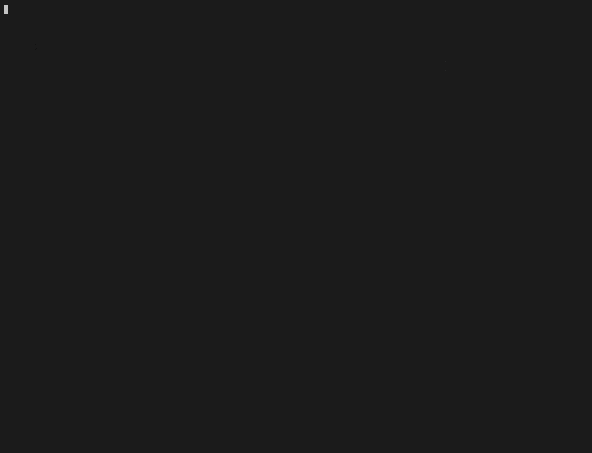

# ELRS Monitor

A **receive-only ExpressLRS monitor** with a live channel dashboard, FHSS tracking,
receiver telemetry, text/JSON output, and IQ replay. Native HackRF reception is
the default; an optional SoapySDR backend is also tested with HackRF.



## Features

- Follows the 80-channel **2.4GHz LoRa** hopping sequence.
- Automatically adapts to validated rate and switch-mode changes.
- Displays channel levels, min/max, sample age, and explicit UNSEEN/HELD/STALE states.
- Decodes receiver-reported RSSI, SNR, link quality, and Model Match status.
- Accepts a binding phrase or UID, or passively discovers a UID during Bind mode.
- Supports deterministic IQ replay and owner-only JSONL frame logs.

Targets **ExpressLRS 4.1.0 / OTA-v4**, non-Gemini:

| Rates | Switch modes |
| --- | --- |
| 50, 150, 250, 500Hz | Hybrid, Wide |
| 100, 333Hz Full | 8ch, 12ch, 16ch |

Live Full 8ch/12ch uses a shared **8/12ch** label because their sync encodings
are indistinguishable. All six PHYs have physical packet regressions; full mode
coverage and long-run reception yield remain experimental.

## Install

Requires Linux/Unix, Python **3.11+**, NumPy, SciPy, and **libhackrf** for the default
backend. The dashboard uses Python's standard `curses` module.

```bash
# Fedora: install the native radio library/tools if needed.
pkexec dnf install hackrf

python3 -m venv .venv
.venv/bin/python -m pip install -e .
```

## Quick start

Close other applications using the SDR, then start the monitor with your
transmitter's binding phrase:

```bash
.venv/bin/elrs-monitor --bind-phrase 'YOUR PHRASE' --tui
```

If Model Match is enabled, supply the matching ID explicitly:

```bash
.venv/bin/elrs-monitor --bind-phrase 'YOUR PHRASE' \
  --model-match on --model-id 0 --tui
```

Live `--rate` and `--switch-mode` are startup hints; validated sync selects the
active configuration. Defaults are **250Hz / Hybrid / Model Match off**.
All settings are CLI-only; no configuration file is loaded.

**Controls:** `q`/`Esc` quit · `Space` pause display · `r` reset min/max ·
arrows/PageUp/PageDown scroll. Minimum terminal size: **80 × 22**.

### SoapySDR alternative

Install SoapySDR ABI 0.8 and the device plugin, then add `--backend soapy`:

```bash
.venv/bin/elrs-monitor --backend soapy --bind-phrase 'YOUR PHRASE' --tui
```

The default selector is `driver=hackrf`; use `--device ARGS` to override it.
Native remains the default, with no automatic failover. Other SDR devices are
not yet RF-validated. See [SoapySDR setup and limitations](docs/soapy.md).

### More examples

Choose exactly one identity: `--bind-phrase`, `--uid`, or `--discover-binding`.
Include matching Model Match settings where applicable.

```bash
# Text/JSON output or a new frame log.
.venv/bin/elrs-monitor --bind-phrase 'YOUR PHRASE' --format json
.venv/bin/elrs-monitor --bind-phrase 'YOUR PHRASE' --tui --jsonl session.jsonl

# Start listening, then put one transmitter into Bind mode.
.venv/bin/elrs-monitor --discover-binding --tui

# Replay headerless signed-int8 IQ: 10Msps, center 2440MHz.
.venv/bin/elrs-monitor --bind-phrase 'YOUR PHRASE' --replay capture.iq \
  --rate 250 --switch-mode Hybrid --pace --tui
```

Discovery continues into normal monitoring after learning a UID. Replay uses
fixed rate/mode settings rather than live adaptation. Run `--help` for all options.

## Limitations and safety

- **Experimental monitoring, not a flight-control receiver.** Retuning and RF
  conditions can lose packets; full-rate reception and latency are not guaranteed.
- No FLRC/GFSK, Gemini, sensor/MAVLink message reassembly, transmission, flashing,
  or active binding. Receiver statistics require a connected receiver and telemetry.
- Binding phrases are identity seeds, **not secrets or encryption keys**; the
  supplied phrase and derived UID are displayed. CRC is not authentication.
- Use low transmitter power and antenna separation. Never connect transmitter
  RF directly to the SDR without appropriate attenuation. HackRF RF amp and
  antenna bias remain off.

## Documentation

- [Usage guide](docs/usage.md) — identity, discovery, profiles, dashboard, and logs
- [SoapySDR backend](docs/soapy.md) — dependencies, device selection, and validation
- [Validation results](docs/validation.md) — physical evidence and known limitations
- [Telemetry timing audit](docs/telemetry-timing.md) — source-derived rules versus calibration

## Development

```bash
.venv/bin/python -m unittest discover -s tests -v
```

## License

**GPL-3.0-only**, without warranty. See [LICENSE](LICENSE) and
[upstream attribution and third-party notices](THIRD_PARTY_NOTICES.md).
This is an independent project, not an official ExpressLRS product.
